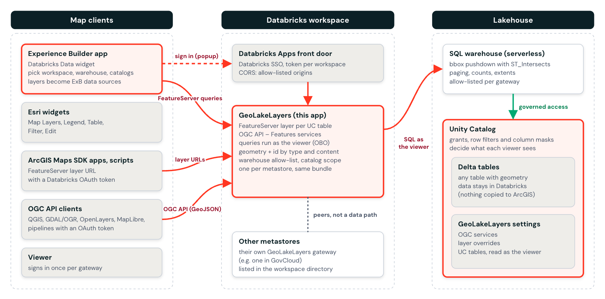
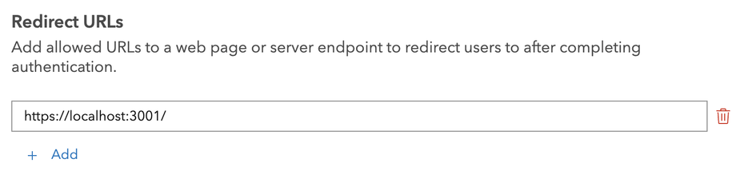

# Databricks Data for ArcGIS Experience Builder

An Experience Builder widget that puts Unity Catalog tables on an ArcGIS map as live layers, backed by
**ArcGateway**, a small Databricks App that serves those tables as ArcGIS FeatureServer layers. Authors pick
tables from one or more Databricks workspaces; viewers sign in with Databricks and see only what Unity Catalog
lets them see. Nothing is copied into ArcGIS: every pan and zoom is a query on a Databricks SQL warehouse.


## How it fits



- **Databricks Data widget** (`widget/databricks-data/`): signs the user in to each workspace, lists the
  tables they can use, and adds them to the map as Experience Builder data sources, so Map Layers, Legend,
  Table and Filter treat them like any other layer.
- **ArcGateway** (`gateway/`): a Databricks App, one per workspace. It turns ArcGIS FeatureServer requests
  (extent, paging, filters, counts) into SQL and runs them **as the signed-in user**. Map Viewer, ArcGIS Pro
  and SDK apps can use its layer URLs too.
- **Your data stays in Unity Catalog.** A table is map-ready if it has an id column and geometry stored as
  GEOMETRY/GEOGRAPHY, WKT, WKB or longitude/latitude columns.

A Databricks sign-in belongs to one workspace, so each workspace runs its own ArcGateway (same code, one
bundle). Workspaces that share a metastore see the same catalogs and can share one gateway.

## Deployment

You need: a recent Databricks CLI (built with v1.17) with a profile for each workspace, Databricks Apps enabled
with user authorization, a serverless SQL warehouse, and ArcGIS Enterprise 11.0 or later (this project is
built and tested against 12.1).

### 1. Deploy ArcGateway to a workspace

ArcGateway is a Databricks Asset Bundle in `gateway/`. Each workspace is a target in
`gateway/databricks.yml`:

```yaml
targets:
  myworkspace:
    workspace:
      host: https://<workspace>.cloud.databricks.com
    variables:
      warehouse_id: <serverless warehouse id>          # queries run here unless an author picks another allowed one
      allowed_origins: https://<portal-host>,https://localhost:3001   # browser origins that may call the gateway
      # optional:
      allowed_warehouses: <id>,<id>                    # extra warehouses authors may pick
      catalogs: "-"                                    # cap on listable catalogs; "-" = none
      directory: prod=https://arcgateway-....databricksapps.com;gov=https://arcgateway-....databricksapps.us
```

Then deploy and start it:

```bash
cd gateway
databricks bundle deploy -t myworkspace --profile <profile>
databricks bundle run gateway -t myworkspace --profile <profile>
```

The app is created as `arcgateway`, open to account users (`CAN_USE`), with user authorization for SQL, and
the warehouse bound as an app resource. Its URL is printed at the end
(`https://arcgateway-<workspace-id>.<region>.databricksapps.com`). Open it in a browser to check it: the
console shows who you are, the workspace, warehouse and allowed origins, and lets you browse tables and
preview them on a map.


What users need in Databricks: `CAN_USE` on the app (the bundle grants it to account users), `CAN_USE` on the
warehouse, and `USE CATALOG` / `USE SCHEMA` / `SELECT` on the tables. Queries run as the user, so the app's
service principal needs no data grants.

To add a workspace later: add a target, deploy it, and add the new gateway to `directory` in every target so
authors can pick it from a list.

### 2. Set up Experience Builder Developer Edition

Custom widgets are built with Developer Edition. Pick the version that matches your Portal: Enterprise 12.1
pairs with Developer Edition **1.20** (ArcGIS Maps SDK 5.0). Download it from Esri's Developer Edition
downloads page (needs an ArcGIS account), unzip it, and install its two parts:

```bash
cd ArcGISExperienceBuilder/server && npm ci && npm start          # https://localhost:3001
cd ArcGISExperienceBuilder/client && npm ci && npm start          # widget compiler (watch mode)
```

Copy the widget into the client and restart the compiler once (it picks up new widgets at start):

```bash
cp -R widget/databricks-data ArcGISExperienceBuilder/client/your-extensions/widgets/
```

Developer Edition signs in to Portal with an OAuth app. In Portal, create **New item → Developer credentials →
OAuth 2.0 credentials for user authentication**:


Add `https://localhost:3001/` as a redirect URL, then give Developer Edition your Portal URL and the new client
ID the first time you open https://localhost:3001.



Add `https://localhost:3001` to the gateway's `allowed_origins` and redeploy it if you haven't.

### 3. Use it in Portal's own Experience Builder (optional)

To make the widget available to everyone in Portal's built-in Experience Builder, host the compiled widget
(`client/dist/widgets/databricks-data`) on a web server that is anonymous, HTTPS with a publicly trusted
certificate, and sends CORS headers for your Portal. Then, as a Portal administrator, add **New item →
Application → Experience Builder widget** with the URL of its `manifest.json`. Add the Portal's address to
each gateway's `allowed_origins`.

## Building an app

1. Add a **Map**, and the **Databricks Data** widget, ideally inside a **Widget Controller** on the map so it
   opens as a panel. Add **Map Layers** and **Legend** (a sidebar works well).
2. In the Databricks Data settings, sign in to a workspace. Its card holds the gateway URL, the SQL warehouse
   and the catalogs viewers can browse. **Add workspace** lists the other gateways from the directory.
3. Under **Layers to load when the app opens**, tick tables in the workspace ▸ catalog ▸ schema ▸ table tree.
   **Show selected only** reviews the picks.
4. Save and publish. Viewers click **Sign in** once per workspace; the start-up layers load, and if browsing
   is on they can add more from the chosen catalogs.


To see a layer's rows, add a **Table** widget, pick the map, and turn on **Display layers generated at
runtime**. Clicking a feature shows its fields when the Map widget's pop-ups are enabled.

## Editing

Databricks layers can be edited with Experience Builder's **Edit** widget or an editable **Table**. Three
switches have to agree:

1. **Gateway (Databricks admin):** `editing: "true"` in the workspace's bundle target. Off by default; while
   it's off, layers advertise only `Query` and edit requests are refused.
2. **App (author):** **Allow editing Databricks layers** in the widget's settings (Viewers section). Each
   workspace card says whether its gateway allows editing.
3. **Unity Catalog (per person):** edits run as the person editing, so they need `MODIFY` on the table.

Editable tables have a real integer id column; tables with a derived id (string ids such as Overture's) and
map-optimized copies stay read-only. Each save is SQL on the Delta table (`INSERT` / `UPDATE` / `DELETE`), so
it takes a second or two: right for corrections, reviews and batch attribute updates, not for high-volume
capture. New features get the next id after the table's current maximum, and there is no row versioning
(the last save wins). For heavy transactional editing, a Lakebase-backed feature service is the better fit.

Edits are accepted only from origins in `allowed_origins` (and the gateway's own pages); values are sent as
SQL parameters and column names are checked against the table.

## Configuration reference

Gateway (bundle variables → app environment; list settings use `-` for "none" because Databricks Apps
rejects empty values):

| Setting | Default | What it does |
|---|---|---|
| `warehouse_id` | required | Bound warehouse; the default for every query |
| `allowed_warehouses` | `-` | Extra warehouses authors may pick; anything else is refused (403) |
| `allowed_origins` | `-` | Browser origins allowed by CORS and by the sign-in handoff |
| `catalogs` | `-` | Optional cap on which catalogs can be listed |
| `exclude_catalogs` | `system,samples,hive_metastore,__databricks_internal` | Never listed |
| `directory` | `-` | Other gateways, `name=url;name=url`, shown in the console and the widget |
| `MAX_ROWS` | `4000` | Features per page |
| `BIG_TABLE_FEATURES` | `250000` | Above this, layers draw only when zoomed in (about zoom 9) |
| `editing` | `"false"` | Master switch for editing on this gateway |

Widget (set in the builder): workspaces (name, gateway URL, warehouse, catalogs viewers can browse), whether
viewers can browse and add tables, whether layers can be edited, start-up layers.

## Security model

- Every request passes the Databricks Apps front door; queries run with the caller's own token, so Unity
  Catalog grants (including row filters and column masks) apply per person.
- The sign-in popup hands the token only to allow-listed origins. Tokens live in memory, never in storage;
  in the builder they are shared between its windows, never in published apps.
- The browser never sends SQL. Table, column and catalog names are checked as plain identifiers; `where`
  clauses are validated; bounding boxes are built from numbers.
- Caches are per user. "Optimize for maps" only replaces tables ArcGateway wrote itself.

## Performance

- Layers above 250,000 features draw only when zoomed in; the widget says so on the layer's row.
- Repeated map requests are cached per user for 5 minutes; warehouse sessions are reused.
- For big tables, use **Optimize for maps** in the console (Explore data → a table). It writes a copy with
  native GEOMETRY and per-row bounding boxes, clustered on them, so map views read only nearby files. The
  original table is not changed.

## Troubleshooting

| Symptom | Cause and fix |
|---|---|
| Sign-in popup says "This site can't be reached" | The workspace card points at an old or wrong gateway URL. Fix the URL in its card. |
| "Could not read the workspace" / "gateway did not answer" | The sign-in expired (about an hour) or the gateway was restarting. Use **Retry** or sign in again. |
| Layer doesn't appear in Map Layers | Its row says "not shown in Map Layers": the data source couldn't be created and a plain layer was added. Check the browser console. |
| Layer disappears when zooming out | It has more than 250,000 features; zoom in, or optimize the table. |
| Requests fail with CORS errors | The page's origin isn't in the gateway's `allowed_origins`. |
| A catalog shows "No map-ready tables" | Its tables lack an id column or a geometry the gateway recognizes. |

## Development

- `gateway/console/`: the console (React + TypeScript, Vite). `npm run console:build` writes `gateway/public/`,
  which is deployed as static files.
- `gateway/provider/`: adapted from `koop-provider-databricks`; `spec.js` works out each table's geometry and id.
- `test/index.html` and `test/browser-test.mjs`: the widget's request path on plain ArcGIS Maps SDK, run
  headless against a deployed gateway. `test/console-shots.mjs` screenshots the console.
- `CLAUDE.md` has the design notes and known gotchas.

## Repository layout

| Path | What it is |
|---|---|
| `widget/databricks-data/` | Experience Builder widget (runtime, settings, shared sign-in, tree) |
| `gateway/` | ArcGateway Databricks App and its bundle (`databricks.yml`) |
| `gateway/console/` | Console source; built into `gateway/public/` |
| `test/` | Browser tests and screenshot scripts |
| `screenshots/` | Images in this README |
