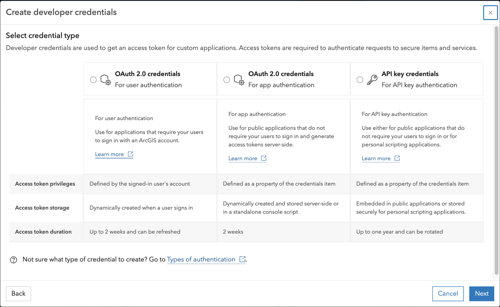

# Databricks Data widget for ArcGIS Experience Builder

A custom Experience Builder widget that puts Unity Catalog tables on an ArcGIS map as live layers. Authors pick
tables from a list; viewers sign in with their Databricks account and see only what Unity Catalog lets them see.
Nothing is copied into ArcGIS: every pan and zoom is a query against a Databricks SQL warehouse.

*A published experience loading two saved layers (H3 place density at two resolutions) straight from Unity Catalog.*

## What's in the box

- **The widget** (`widget/databricks-data/`). Signs the user in to Databricks, lists the tables they can use, and
  adds them to the experience's map. Built for Experience Builder Developer Edition 1.20, which matches
  ArcGIS Enterprise 12.1.
- **The feature gateway** (`gateway/`). A Databricks App that serves any Unity Catalog table as a standard ArcGIS
  FeatureServer layer. The widget talks to it, but so can Map Viewer, ArcGIS Pro or any ArcGIS Maps SDK app.

## Using the widget

### 1. Add it to an experience

Drag a **Map** widget and the **Databricks Data** widget (under *Custom*) onto the page. In the Databricks Data
settings, choose the map it should draw on.

### 2. Pick the layers the app opens with

In the widget's settings, under **Layers to load when the app opens**, sign in to Databricks and tick tables.
These are saved with the experience. The switch **Let viewers browse and add tables** decides whether viewers
also get the full table list or a fixed set of layers.

You can also add tables straight from the list on the canvas in Live view. While the settings panel is open,
anything you add or remove there is ticked or unticked in settings too.

Each layer shows its progress (Adding, Drawing, On map, Failed) and how long it took. Clicking a table that's
already on the map zooms to it.

### 3. Save, publish, and share

Save and publish as usual. A viewer opening the app sees a sign-in button; one click opens a Databricks sign-in
popup, and the saved layers load once it closes.

## How sign-in and permissions work

- The widget opens the gateway's sign-in page in a popup. The user signs in with Databricks SSO there, and the page
  hands their token back to the Experience Builder page. It only does this for origins on the gateway's allow-list.
- The widget attaches that token to every map request it sends to the gateway.
- The gateway runs each query as that user, so Unity Catalog grants decide which tables appear in the list and
  which rows come back. Someone without access to a table sees that layer fail, not someone else's data.
- The token lives in memory only. Reloading the page asks the user to sign in again.

ArcGIS sign-in is separate and unchanged: Experience Builder still signs users in to Portal with its own
developer credentials.

## One-time setup

### Portal: developer credentials for Experience Builder

Experience Builder Developer Edition signs in to Portal through an OAuth app. In Portal, create
**New item → Developer credentials → OAuth 2.0 credentials for user authentication**:

Add the Experience Builder address as a redirect URL (for Developer Edition, `https://localhost:3001/`), then give
the new client ID to Developer Edition when it asks for your Portal.

### Databricks: the feature gateway

The gateway is deployed as the Databricks App `databricks-exb-gateway` on the your-workspace workspace and is open to
all account users. Opening its URL in a browser shows who you're signed in as and every table it can serve for
you, with links to each layer:

A table shows up if it has an integer id column (`objectid`, `oid`, `fid`, `bigid` or `id`) and geometry in one of
these forms: a GEOMETRY or GEOGRAPHY column, a WKT or WKB column, or longitude/latitude columns. The gateway is a
Databricks Asset Bundle (`gateway/databricks.yml`): each workspace is a target with its SQL warehouse, the
Portal/Experience Builder addresses allowed to call it, and optionally which catalogs to list. Nothing about a
workspace is hardcoded, so the same code deploys anywhere (steps in `CLAUDE.md`).

### The widget in Developer Edition

Copy `widget/databricks-data` into `client/your-extensions/widgets/` of an Experience Builder Developer Edition
1.20 install, then start Developer Edition as Esri documents. The widget appears under *Custom* in the widget panel.

## Status

Working end to end in Experience Builder Developer Edition 1.20 against ArcGIS Enterprise 12.1: Databricks sign-in,
per-user table list, point, line and polygon layers, saved start-up layers in published apps.

Not done yet:

- Registering the widget on Portal so it shows up in Portal's own Experience Builder. That needs the built widget
  hosted on HTTPS with a publicly trusted certificate.
- Large tables are slow to draw. National tables like Overture buildings take about a minute; tables with tens of
  thousands of features take a few seconds.
- Layers come from whole tables. Filters and views per layer are the next step.

## Repository layout

| Path | What it is |
|---|---|
| `widget/databricks-data/` | The Experience Builder widget (runtime, settings panel, shared sign-in) |
| `gateway/` | The Databricks App. `provider/` is adapted from `koop-provider-databricks` to work per table and per user |
| `test/` | A plain ArcGIS Maps SDK page and a headless browser test for the widget's request path |
| `screenshots/` | Images used in this README |
