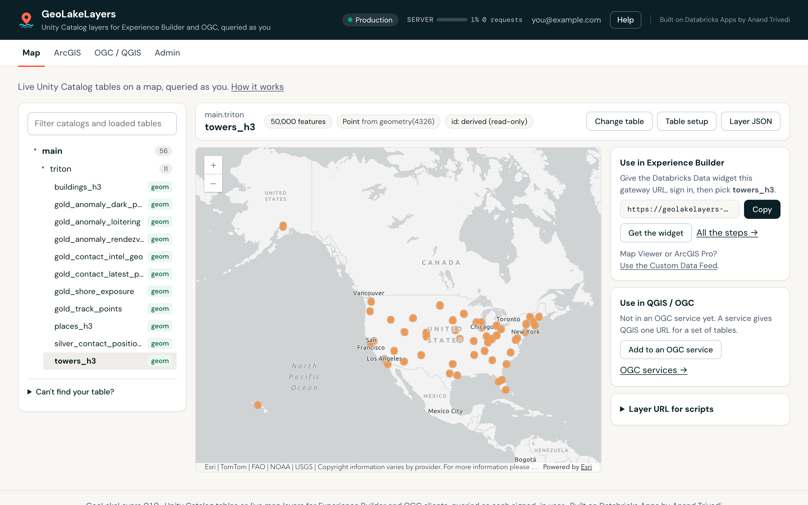
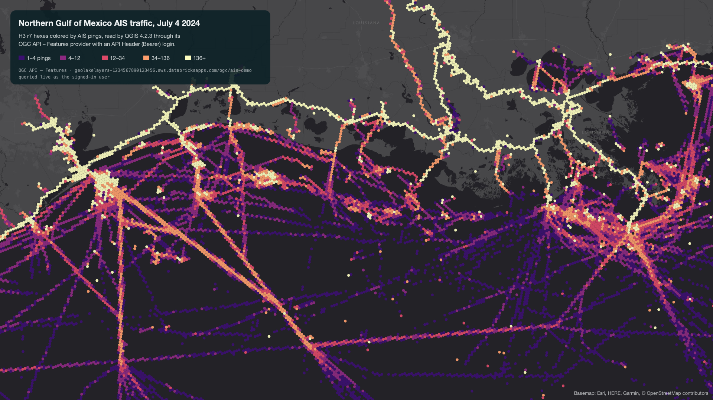
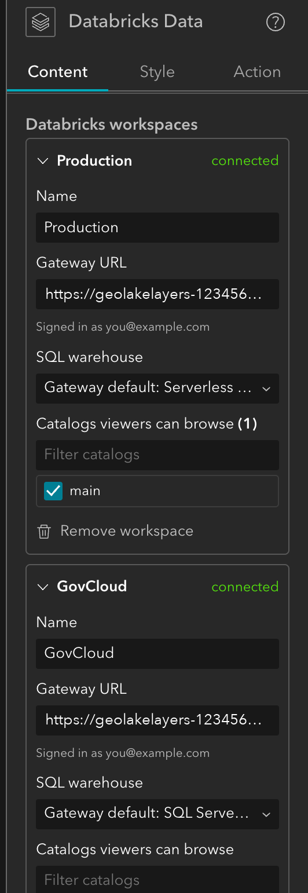
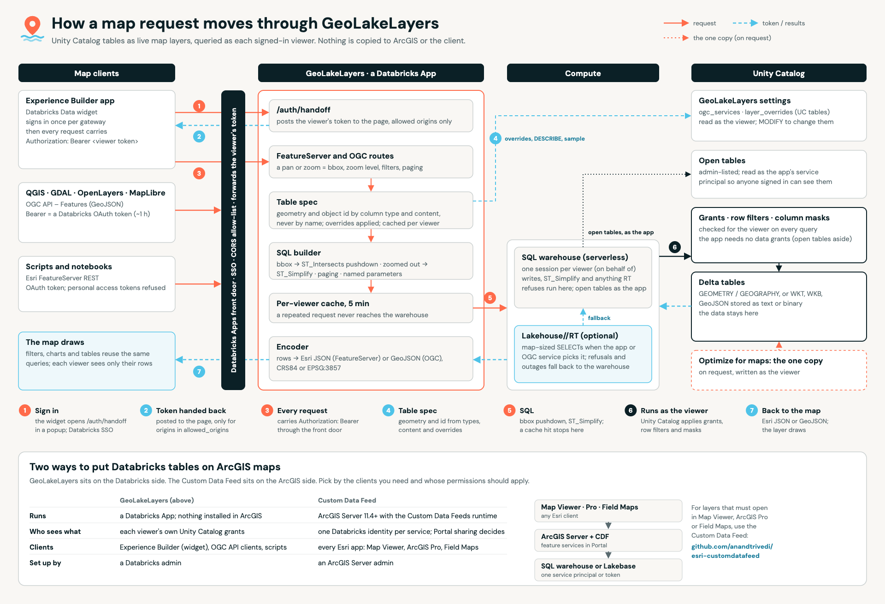
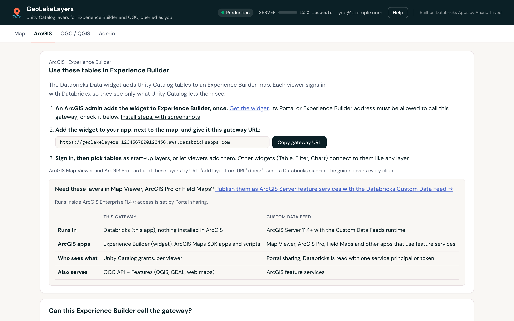
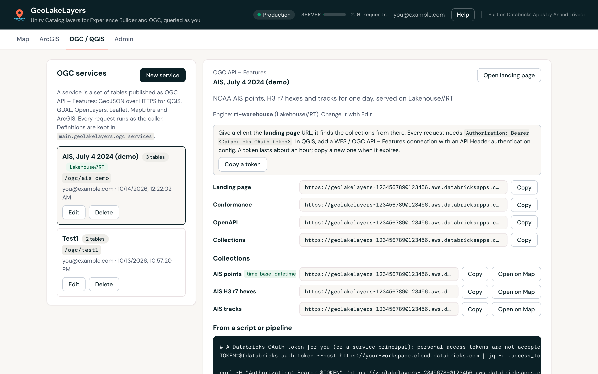
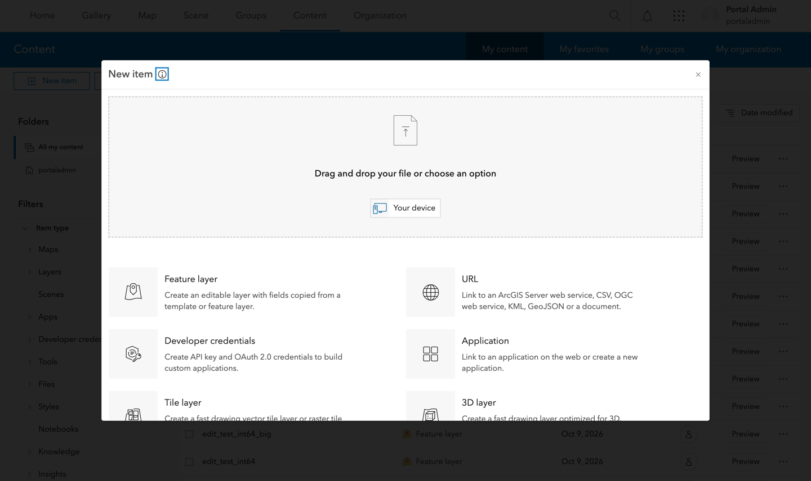
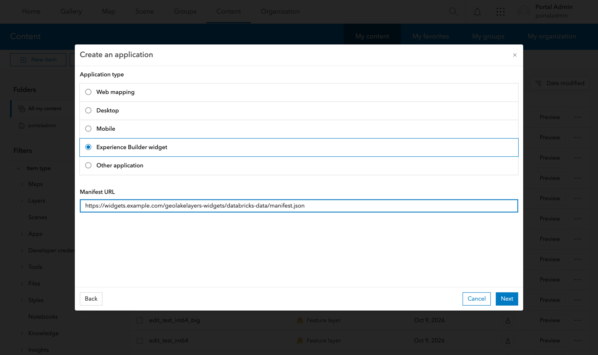
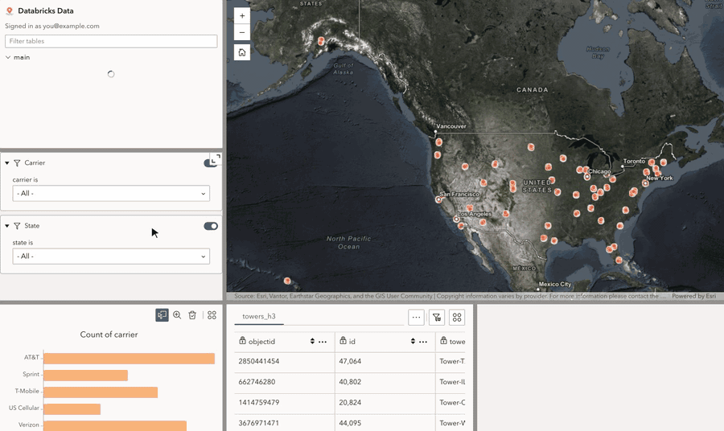

# GeoLakeLayers

*Built on Databricks Apps by Anand Trivedi. Provided under the [Databricks License](LICENSE), which limits use to use with Databricks services.*

> **Databricks support doesn't cover this project.** It is provided as-is and is not an official Databricks
> product. Test it in your own environment before relying on it. For bugs and questions, open a GitHub issue; the
> maintainers answer on a best-effort basis. Report security issues as described in [SECURITY.md](SECURITY.md).

Unity Catalog tables as live map layers for Experience Builder and OGC clients (QGIS, GDAL, web maps), served by
a Databricks App and queried as each signed-in user. Nothing to install in ArcGIS. The layers come in two forms:

- **ArcGIS FeatureServer layers** for Experience Builder apps, through the **Databricks Data** widget in this
  repository (`widget/databricks-data/`).
- **OGC API – Features services** for QGIS, GDAL, OpenLayers, Leaflet, MapLibre and scripts. These need only
  GeoLakeLayers, no widget.

## Screenshots


*Published experience: Unity Catalog tables as live layers, with Map Layers and Legend treating them like any other layer.*


*The console's Map tab: a table drawn live as the signed-in user, with the URLs to use it in Experience Builder, QGIS or a script.*


*QGIS reading an OGC API – Features service, one collection per Unity Catalog table.*


*The widget's settings: one card per workspace with its gateway, warehouse, catalogs and start-up layers.*

Viewers sign in with Databricks and see only what Unity Catalog lets them see. Nothing is copied: every pan and
zoom is a query on a Databricks SQL warehouse, with results cached per user for up to five minutes. (The one
exception is **Optimize for maps**, which writes a map-friendly copy of a table when you ask for it.)

**GeoLakeLayers or the Custom Data Feed?** Both put Databricks tables on ArcGIS maps; they sit on opposite sides.

| | GeoLakeLayers | [Custom Data Feed](https://github.com/anandtrivedi/esri-customdatafeed) |
|---|---|---|
| Runs | on the Databricks side, as a Databricks App | on the ArcGIS side, in ArcGIS Server 11.4+ |
| Who sees what | each viewer's own Unity Catalog grants | one Databricks identity per service; Portal sharing decides |
| Clients | Experience Builder (widget), OGC API clients, scripts | every Esri app: Map Viewer, ArcGIS Pro, Field Maps |
| Set up by | a Databricks admin | an ArcGIS Server admin |

Use the Custom Data Feed when layers have to open in Map Viewer, ArcGIS Pro or Field Maps; use GeoLakeLayers for
per-user access, OGC clients, or when nothing can be installed in ArcGIS.


Which client uses what (Experience Builder, OGC clients like QGIS and GDAL, scripts) is covered in
[docs/guide.md](docs/guide.md). The same page is the console's **Help** panel.

## How it fits



Each numbered step is explained in [docs/architecture](docs/architecture/README.md).

- **Databricks Data widget** (`widget/databricks-data/`): signs the user in to each workspace, lists the
  tables they can use, and adds them to the map as Experience Builder data sources, so Map Layers, Legend,
  Table and Filter treat them like any other layer.
- **GeoLakeLayers** (`gateway/`): a Databricks App, one per Unity Catalog metastore. It turns ArcGIS FeatureServer
  requests (extent, paging, filters, counts) into SQL and runs them **as the signed-in user**. Scripts and
  ArcGIS Maps SDK apps can use its layer URLs when they send a Databricks OAuth token; ArcGIS Map Viewer and
  ArcGIS Pro can't add them by URL yet, because they can't send a Databricks sign-in. It also publishes sets of tables as **OGC API – Features**
  services for QGIS, GDAL, OpenLayers, MapLibre and pipelines (see [OGC API – Features](#ogc-api--features)).
- **Your data stays in Unity Catalog.** Any table with geometry can be a layer: a GEOMETRY/GEOGRAPHY
  column, WKT, WKB or GeoJSON in a text or binary column, or longitude/latitude columns (see
  [How tables are read](#how-tables-are-read)).

One gateway per Unity Catalog metastore is enough. People sign in to the workspace that hosts it, and it can
serve any catalog bound to that workspace, so workspaces that share a metastore share one gateway. A
workspace on another metastore (another region, or GovCloud) gets its own gateway from the same bundle.

### New to Databricks or Experience Builder?

- **Workspace**: a Databricks deployment you sign in to, at an address like `https://<name>.cloud.databricks.com`.
- **Unity Catalog**: Databricks' catalog and permission system. Tables are named `catalog.schema.table`, and
  grants such as `SELECT` (read) and `MODIFY` (write) decide who can do what. A **metastore** is the top-level
  Unity Catalog container for a region; workspaces attached to the same one see the same catalogs.
- **SQL warehouse**: the compute that runs queries. People need `CAN USE` on one to query through it.
- **Databricks App**: a web app hosted inside the workspace. Databricks signs people in before a request
  reaches it, and GeoLakeLayers runs each query with that person's identity.
- **OAuth token**: what scripts and QGIS send as `Authorization: Bearer <token>`. Get one with
  `databricks auth token` (Databricks CLI), or from the console's **Copy token** button. Tokens last about an
  hour. Personal access tokens don't work, because Databricks Apps only accept OAuth.
- **Experience Builder Developer Edition**: Esri's downloadable Experience Builder, which runs on your own
  machine and is where custom widgets such as this one are installed and built. Portal's built-in Experience
  Builder can use the widget once it is built and hosted (step 3).

## Deployment

**Step-by-step with screenshots: [docs/install.md](docs/install.md)** (also in the console's Help). The short
version follows.

You need:

- the [Databricks CLI](https://docs.databricks.com/aws/en/dev-tools/cli/install) (tested with v1.17), signed
  in to the workspace with `databricks auth login --host <workspace URL> --profile <name>`;
- permission to create a Databricks App in that workspace, with user authorization available (an admin may
  need to turn on Databricks Apps first);
- a SQL warehouse. Serverless is recommended; a Pro warehouse also works. Spatial SQL (`ST_*` functions) has
  to be available on it;
- for the Experience Builder path, Experience Builder Developer Edition. Tested with Developer Edition 1.20 and
  ArcGIS Enterprise 12.1; other versions haven't been tried.

There are two paths. **OGC clients only** (QGIS, GDAL, web maps, scripts): step 1, with `ogc_services_table`
set (below). **Experience Builder**: step 1, then install the widget (step 2, and step 3 if you use Portal's
own Experience Builder).

### 1. Deploy GeoLakeLayers (both paths)

GeoLakeLayers is a Databricks Asset Bundle in `gateway/`. Your deployment targets go in
`gateway/targets.local.yml`, which is gitignored, so your hosts and warehouse ids stay out of the repo. Start
from the example:

```bash
cp gateway/targets.example.yml gateway/targets.local.yml
```

Each Unity Catalog metastore you serve is one target:

```yaml
targets:
  myworkspace:
    workspace:
      host: https://<workspace>.cloud.databricks.com
    variables:
      warehouse_id: <serverless warehouse id>          # queries run here unless an author picks another allowed one
      allowed_origins: https://<portal-host>,https://localhost:3001   # browser origins that may call the gateway
      # optional:
      allowed_warehouses: <id>,<id>                    # extra warehouses authors may pick
      catalogs: "-"                                    # cap on listable catalogs; "-" = none
      directory: east=https://geolakelayers-<id>.aws.databricksapps.com;gov=https://geolakelayers-<id>.aws-gov.databricksapps.us
```

Then deploy and start it:

```bash
cd gateway
databricks bundle deploy -t myworkspace --profile <profile>
databricks bundle run gateway -t myworkspace --profile <profile>
```

> [!WARNING]
> Changing the bundle name or `app_name` later **replaces** the app: a new URL and a new service principal, so
> every Experience Builder app, QGIS connection and `directory` entry using the old URL breaks.

The app is created as `geolakelayers`, open to account users (`CAN_USE`), with user authorization for SQL, and
the warehouse bound as an app resource. Its URL is printed at the end
(`https://geolakelayers-<workspace-id>.<region>.databricksapps.com`). Open it in a browser to check it: the
console opens on a map of a table you can read, with the URLs to use it in Experience Builder, QGIS or a
script beside it; the ArcGIS, OGC / QGIS and Admin tabs cover each client and the gateway's health.






Who needs what. Queries run as the person, so the app's service principal needs no data grants.

| Who | Needs |
|---|---|
| Everyone (viewers, OGC clients, scripts) | `CAN USE` on the app (the bundle grants it to `account users`; change `permissions` in `databricks.yml` to narrow it), `CAN USE` on the warehouse, and `USE CATALOG`, `USE SCHEMA` and `SELECT` on the tables they map. If the settings tables are on: `SELECT` on them |
| Authors who set layer overrides or define OGC services | `MODIFY` on the overrides or OGC services table |
| Authors who use **Optimize for maps** | `CREATE TABLE` (with `USE SCHEMA`, `USE CATALOG`) on the target schema |
| Editors | `MODIFY` on the table, plus editing turned on (`editing: "true"`) |
| Whoever creates a settings table from the console | `CREATE TABLE` on its schema, and `MANAGE` or ownership to grant everyone `SELECT` on it |

Before a write, the console reads your grants from `information_schema` and warns if none allows it. Creating
a settings table and Optimize for maps stop at that point, with a **Try anyway** button: metastore admins and
some indirect grants don't show there. Any refusal from Databricks is shown as the missing privilege and the
object, not as a raw SQL error.

**OGC services** are off until `ogc_services_table` names a table, for example
`main.geolakelayers.ogc_services`. Set it in your target and redeploy, then open the console's **OGC / QGIS** tab
and click **Create table** (or create it yourself), grant `SELECT` on it to everyone who reads services and
`MODIFY` to those who define them, and click **New service** to pick tables. Layer overrides work the same
way with `layer_overrides_table`.

You're done with the OGC path when the console opens and an OGC service's landing page answers a request
that carries `Authorization: Bearer <token>`.

**Compute.** The app runs on Medium compute (2 vCPU, 6 GB) by default. Long line layers drawn at full detail
can use a lot of memory; set `compute_size: LARGE` and `node_heap_mb: "8192"` in your target if the console's
**Server** gauge often runs high. Large uses twice the DBUs.

To add a workspace on the same metastore: bind its catalogs to the gateway's workspace and add its Experience
Builder address to `allowed_origins`. For a workspace on another metastore: add a target, deploy it, and add
the new gateway to `directory` in every target so authors can pick it from a list.

### 2. Install the widget in Experience Builder Developer Edition (Experience Builder path)

Custom widgets are built in Developer Edition (version **1.20** pairs with ArcGIS Enterprise 12.1). Start its
server and client, copy `widget/databricks-data` into `client/your-extensions/widgets/`, and restart the
client once. Developer Edition signs in to Portal through a **Developer credentials → OAuth 2.0 credentials for
user authentication** item whose redirect URL is exactly `https://localhost:3001/`.
[docs/install.md § 3](docs/install.md#3-install-the-widget-in-developer-edition) has every screen.



The widget's own notes are in [widget/databricks-data/README.md](widget/databricks-data/README.md).

### 3. Use it in Portal's own Experience Builder (optional)

Build the widget (`npm run build:for-download` in the Developer Edition client, output in
`dist-download/widgets/databricks-data`), host that folder on a web server, and register its `manifest.json`
in Portal as **New item → Application → Experience Builder widget**. Then share the item with app authors.



> [!IMPORTANT]
> The web server must be **anonymous**, **HTTPS with a publicly trusted certificate**, and send **CORS
> headers for your Portal's origin**, or Experience Builder can't load the widget even though the item
> registers fine. [docs/install.md § 4](docs/install.md#4-register-the-widget-in-portals-experience-builder)
> has a Tomcat `web.xml` and two `curl` checks.

For either path, add the Experience Builder's origin (`https://localhost:3001`, your Portal) to each gateway's
`allowed_origins` and **redeploy**; the console's **Can this Experience Builder call the gateway?** check tells
you if it's allowed.

## Building an app

1. Add a **Map**, and the **Databricks Data** widget, ideally inside a **Widget Controller** on the map so it
   opens as a panel. Add **Map Layers** and **Legend** (a sidebar works well).
2. In the Databricks Data settings, sign in to a workspace. Its card holds the gateway URL, the SQL warehouse
   and the catalogs viewers can browse. **Add workspace** lists the other gateways from the directory.
3. Under **Layers to load when the app opens**, tick tables in the workspace ▸ catalog ▸ schema ▸ table tree.
   **Show selected only** reviews the picks.
4. Save and publish. Viewers click **Sign in** once per workspace; the start-up layers load, and if browsing
   is on they can add more from the chosen catalogs.


Start-up layers are also the widget's output data sources, so other widgets connect to them in the builder like
to any layer: a **Filter** narrows the map, and a **Chart** and **Table** on the same data follow along. Filter
dropdowns and chart statistics run as SQL over the whole table, not just the features on screen.


*Filter, Chart and Table connected to a start-up layer: picking a carrier filters the map, the chart and the table.*

For layers viewers add at runtime, add a **Table** widget, pick the map, and turn on **Display layers generated
at runtime**. Clicking a feature shows its fields when the Map widget's pop-ups are enabled.

## Editing

Databricks layers can be edited with Experience Builder's **Edit** widget or an editable **Table**. Three
switches have to agree:

1. **Gateway (Databricks admin):** `editing: "true"` in the workspace's bundle target. Off by default; while
   it's off, layers advertise only `Query` and edit requests are refused.
2. **App (author):** **Allow editing Databricks layers** in the widget's settings (Viewers section). Each
   workspace card says whether its gateway allows editing.
3. **Unity Catalog (per person):** edits run as the person editing, so they need `MODIFY` on the table.

The gateway switch and `MODIFY` are what enforce editing; the widget's switch only shows or hides editing in an app.

Editable tables have a real integer id: a single-column primary key, or an id column picked as an override.
Tables with a derived id and map-optimized copies stay read-only. Each save is SQL on the Delta table (`INSERT` / `UPDATE` / `DELETE`), so
it takes a second or two: right for corrections, reviews and batch attribute updates, not for high-volume
capture. New features get the next id after the table's current maximum, so two people adding features at
the same moment can collide; there is no row versioning (the last save wins). Edits in one save are applied
one by one, not as a transaction: if one fails, the ones before it stay, and each gets its own result. Once
one is refused for permissions, the rest aren't tried. For heavy transactional editing, a Lakebase-backed
feature service is the better fit.

Edits are accepted only from origins in `allowed_origins` (and the gateway's own pages); values are sent as
SQL parameters and column names are checked against the table.

## How tables are read

GeoLakeLayers works out each table's geometry and object id from column types and values, never from
column names.

- Geometry: a GEOMETRY or GEOGRAPHY column is used by its type (another SRID is reprojected to 4326).
  Otherwise GeoLakeLayers samples the table's text and binary columns with `try_to_geometry`; a column whose
  values parse as WKT, EWKT, GeoJSON or WKB (95% of 200 sampled values) is the geometry, in the SRID the
  values carry, else 4326.
- Object id: the table's Unity Catalog primary key when it is a single integer column. Otherwise an id
  derived from a hash of the whole row: stable while the row doesn't change, fine for viewing, but those
  layers are read-only.
- Listing: the catalog tree lists tables with a GEOMETRY/GEOGRAPHY column straight from metadata. Geometry
  stored as text or binary needs the values, so it is found when a table is opened, or for a whole schema
  with **Scan schema** on the console's Map tab (under "Can't find your table?"). **Open table** opens any table by name.

When that isn't right (geometry in two longitude/latitude columns, a mostly empty geometry column, the
wrong one of two geometry columns, or a real id column without a declared primary key), set an override:
Explore → a table → **How it's read → Change**. Overrides are kept in a Unity Catalog table
(`layer_overrides_table` in the bundle) and apply to everyone who uses the table through this gateway.
**Create overrides table** makes it once and grants SELECT to account users. People also need USE CATALOG
and USE SCHEMA on its catalog and schema (`GRANT USE SCHEMA ON SCHEMA <catalog>.<schema> TO \`account users\``);
without them their reads fall back to automatic detection. Grant MODIFY on the table to the people who
should set overrides. Pick an id column only if its values are unique and never change:
ArcGIS selects, pages and edits by it.

To make a table editable without an override, declare its primary key:
`ALTER TABLE c.s.t ALTER COLUMN id SET NOT NULL; ALTER TABLE c.s.t ADD CONSTRAINT t_pk PRIMARY KEY (id)`.

## OGC API – Features

Besides ArcGIS layers, GeoLakeLayers publishes OGC API – Features services: pick tables in the console, save
them under a name, and each table becomes a collection at
`https://<gateway>/ogc/<service>/collections/<table>/items`. Responses are GeoJSON. The service implements
Part 1 (Core, GeoJSON, OpenAPI 3.0) and Part 2 (CRS84 and EPSG:3857).

Turning it on (Databricks admin): set `ogc_services_table` in the bundle target to a Unity Catalog table
name, for example `main.geolakelayers.ogc_services`, and redeploy. Then open the console's **OGC / QGIS**
tab and use **Create table** once (it needs CREATE TABLE on that schema). Grant SELECT on the table to the
people and service principals that read services, and MODIFY to the people who define them.

Defining a service: **OGC services → New service**, tick tables in the catalog tree, set a title per
table and optionally a time field (enables `datetime` filtering), and save. The service's card lists its
landing page, conformance, OpenAPI, collection and items URLs, with copyable `curl` and GDAL commands and
a map preview.

| Path | What it returns |
|---|---|
| `/ogc/<service>` | Landing page (links to the API definition, conformance and collections) |
| `/ogc/<service>/conformance` | Conformance classes |
| `/ogc/<service>/api` | OpenAPI 3.0 definition, with each collection's queryable fields |
| `/ogc/<service>/collections` | One collection per table: extent, time range, CRS list |
| `/ogc/<service>/collections/<id>/items` | Features as GeoJSON, paged with `next` links |
| `/ogc/<service>/collections/<id>/items/<fid>` | One feature |
| `/ogc/<service>/collections/<id>/queryables` | Fields that can be filtered with `?field=value` |

Items accept `bbox` (and `bbox-crs`), `crs` (CRS84 or `http://www.opengis.net/def/crs/EPSG/0/3857`),
`limit` (default 100, at most `MAX_ROWS`), `offset`, `datetime` (instant or interval, for collections with
a time field), `properties` (fields to return) and `field=value` filters on queryable fields. Bounding boxes
are 2D (four numbers). The `next` links page with a `cursor` on the feature id, which stays fast and doesn't
skip or repeat rows when the table changes between pages; `offset` works too, for clients that use it.
Unknown parameters are refused with a 400, as the standard requires, so a typo never returns the whole table.

Who can call it: everything still goes through the Databricks Apps front door, so clients need a
Databricks OAuth token. Personal access tokens are not accepted.

- Browser maps on the gateway's own pages use the session; on another site they need an allow-listed
  origin and a Bearer token, the same way the Experience Builder widget signs in.
- Scripts and pipelines send `Authorization: Bearer <token>`. For a person:
  `databricks auth token --host <workspace URL>`. For a service principal: its OAuth M2M token from
  `<workspace>/oidc/v1/token` (client credentials). The service principal needs CAN_USE on the app,
  CAN_USE on the warehouse and SELECT on the tables.

```bash
TOKEN=$(databricks auth token --host https://<workspace> | jq -r .access_token)
curl -H "Authorization: Bearer $TOKEN" "https://<gateway>/ogc/<service>/collections/<id>/items?limit=10&bbox=-77.2,38.8,-76.9,39.0"
umask 077; printf 'Authorization: Bearer %s\n' "$TOKEN" > ~/.geolakelayers-header   # GDAL reads the header from a file
ogrinfo --config GDAL_HTTP_HEADER_FILE ~/.geolakelayers-header -ro -so "OAPIF:https://<gateway>/ogc/<service>"
```

See it in QGIS, OpenLayers, MapLibre GL, Leaflet and GDAL, with connection steps for each:
[docs/ogc-clients.md](docs/ogc-clients.md).


Queries run as the caller, exactly like the ArcGIS layers, so Unity Catalog grants (and row filters and
column masks) decide what each client gets. Collections the caller can't read are left out of their
collection list. The services are read-only.

## Lakehouse//RT (low-latency reads, optional, Beta)

Nothing in GeoLakeLayers requires this; everything works on a regular SQL warehouse. A map pan sends dozens of
small read queries at once, which is the workload Lakehouse//RT is built for, so a gateway can offer a
Lakehouse//RT warehouse next to its regular one:

1. A workspace admin enables the **Lakehouse RT** preview (workspace menu → Previews) and creates a
   **Real-Time** SQL warehouse (Compute → SQL Warehouses → Create → Real-Time). It is in Beta; the account
   may need to be enabled first.
2. Give viewers CAN_USE on it, as on the regular warehouse. Warehouse permissions use workspace groups
   (`users`, not `account users`):
   `databricks warehouses update-permissions <id> --json '{"access_control_list":[{"group_name":"users","permission_level":"CAN_USE"}]}'`
   (`update-permissions` adds to the existing permissions; `set-permissions` would replace them)
3. Add its id to `allowed_warehouses` in the gateway's bundle target and redeploy. GeoLakeLayers recognizes
   Lakehouse//RT warehouses by their type; nothing else to configure.

Then pick it as the engine:

- Experience Builder: in the widget's settings, each workspace's warehouse list labels it
  "Lakehouse//RT, low-latency reads".
- OGC API services: the service editor in the console has an **Engine** picker. New services default to a
  Lakehouse//RT warehouse when the gateway has one. OGC clients can't choose a warehouse themselves, so the
  service decides; if its warehouse is later removed from the allow-list, it reads on the bound warehouse.

Reads run on Lakehouse//RT, over the Statement Execution API and as the viewer: features, counts, extents
and also the metadata GeoLakeLayers reads to work out a table's layout (DESCRIBE, information_schema). Edits,
overrides and OGC service changes run on the bound warehouse, which must be a regular SQL warehouse, and so
do simplified line and polygon tiles (no ST_Simplify on Lakehouse//RT yet). Tables with row filters or
column masks (not supported on Lakehouse//RT yet) are detected before the first query and read on the
bound warehouse. When Lakehouse//RT refuses a query, what happens depends on why: a missing function sends
statements using it to the bound warehouse, a table it can't serve stays on the bound warehouse for hours
(minutes when the reason is unclear), and repeated outages or timeouts send everything to the bound
warehouse for a short cool-down. Layers keep drawing either way. `/api/realtime` shows how many queries it
served, what it sent elsewhere, and why. `test/rt-contract.mjs` checks these behaviors against a real
Lakehouse//RT warehouse; [docs/optimizations.md](docs/optimizations.md) records what was measured and the
design choices that follow from it.

Limits while it's in Beta: managed tables only, no row filters or column masks yet, read-only, not in
GovCloud. Spatial SQL works (tested on a Lakehouse//RT warehouse in October 2026: ST_AsGeoJSON,
ST_Intersects, ST_GeomFromText/WKB, try_to_geometry, ST_Transform, H3), although the public docs still list
it as unsupported. Map-optimized copies (bounding-box columns and clustering) suit it best.

Measured on 1M generated points (one 2,000-feature page in a bounding box): about 15–65 ms of warehouse
time on Lakehouse//RT against about 1.2 s on a regular serverless warehouse; seen from a client, about
160 ms against 600 ms per page, and a 24-tile map pan finishing in 1.0 s against 1.8 s. Real tables add
file reads, so expect less of a gap on big unclustered tables.

On real tables (October 2026, Lakehouse//RT vs the regular Serverless Starter warehouse, timed from
a client): an AIS points page (270 MB table, native GEOMETRY) 330–500 ms vs 1.5–2.0 s, and a 24-tile pan
1.5 s vs 6.3 s; a bbox count 140 ms vs 1.1–1.4 s; the map-optimized Overture places copy 125 ms vs 1.1 s;
AIS H3 hexes 125–160 ms vs 0.8–1.2 s. Through GeoLakeLayers's FeatureServer query (2,000 features): about
300 ms vs 1.05–1.15 s. The smallest Lakehouse//RT size (Small, 12 DBU/hour) matched X-Large on all of these,
including 24 tiles at once, so start small and let autoscaling handle concurrency.

## Configuration reference

Gateway (bundle variables → app environment; list settings use `-` for "none" because Databricks Apps
rejects empty values):

| Setting | Default | What it does |
|---|---|---|
| `warehouse_id` | required | Bound warehouse; the default for every query |
| `allowed_warehouses` | `-` | Extra warehouses authors and OGC services may pick (Lakehouse//RT ones are recognized by type); anything else is refused (403) |
| `allowed_origins` | `-` | Browser origins allowed by CORS and by the sign-in handoff |
| `catalogs` | `-` | Optional cap on which catalogs can be listed |
| `exclude_catalogs` | `system,samples,hive_metastore,__databricks_internal` | Never listed |
| `directory` | `-` | Other gateways, `name=url;name=url`, shown in the console and the widget |
| `widget_source` | the widget's GitHub folder | Where ArcGIS admins get the widget (linked from the console); `-` hides the link |
| `cdf_source` | the Custom Data Feed repo | Where to get the ArcGIS Custom Data Feed provider, for layers in Map Viewer and ArcGIS Pro; `-` hides it |
| `MAX_ROWS` | `4000` | Features per page |
| `BIG_TABLE_FEATURES` | `250000` | Above this, layers draw only when zoomed in (about zoom 9) |
| `editing` | `"false"` | Master switch for editing on this gateway |
| `layer_overrides_table` | `-` | Unity Catalog table holding geometry/id overrides; `-` turns overrides off |
| `ogc_services_table` | `-` | Unity Catalog table holding OGC API service definitions; `-` turns OGC API off |
| `compute_size` | `MEDIUM` | App compute: `MEDIUM` (2 vCPU, 6 GB) or `LARGE` (4 vCPU, 12 GB) |
| `node_heap_mb` | `"3072"` | Node heap limit; about half the app's memory (`"8192"` on `LARGE`) |
| `app_name` | `geolakelayers` | Name of the Databricks App |

Allowed origins are compared the way browsers send them (scheme, host and port), so a trailing slash or a path
in the setting is ignored.

Widget (set in the builder): workspaces (name, gateway URL, warehouse, catalogs viewers can browse), whether
viewers can browse and add tables, whether layers can be edited, start-up layers.

## Security model

- Every request passes the Databricks Apps front door; queries run with the caller's own token, so Unity
  Catalog grants (including row filters and column masks) apply per person.
- The sign-in popup hands the token only to allow-listed origins. Tokens live in memory, never in storage;
  in the builder they are shared between its windows, never in published apps.
- The browser never sends SQL. Table, column and catalog names are checked as plain identifiers; `where`
  clauses are validated; bounding boxes are built from numbers.
- Caches are per user. "Optimize for maps" only replaces tables GeoLakeLayers wrote itself.
- The app is open to all account users on purpose: what anyone can read or change is decided by Unity Catalog.
  The catalog cap limits what the widget lists, not what people can access.
- Open tables are the one exception, and only a Databricks admin can set them: tables named in the bundle
  variable `open_tables` are read as the app's service principal (on the bound warehouse), so everyone who
  can sign in sees them whatever their own grants. Use it for data that is meant to be public within the
  account; grant the app's service principal SELECT on each table. Every other table still runs as the
  caller, and edits always do. Apps can't turn this on.

## Performance

- Layers above 250,000 features draw only when zoomed in; the widget says so on the layer's row.
- Repeated map requests are cached per user for 5 minutes; warehouse sessions are reused.
- For big tables, use **Optimize for maps** in the console (Map → a table → Table setup). It writes a copy with
  native GEOMETRY and per-row bounding boxes, clustered on them, so map views read only nearby files. The
  original table is not changed.

## Troubleshooting

| Symptom | Cause and fix |
|---|---|
| Sign-in popup says "This site can't be reached" | The workspace card points at an old or wrong gateway URL. Fix the URL in its card. |
| "Could not read the workspace" / "gateway did not answer" | The sign-in expired (about an hour) or the gateway was restarting. Use **Retry** or sign in again. |
| Layer doesn't appear in Map Layers | Its row says "not shown in Map Layers": the data source couldn't be created and a plain layer was added. Check the browser console. |
| Layer disappears when zooming out | It has more than 250,000 features; zoom in, or optimize the table. |
| Requests fail with CORS errors | The page's origin isn't in the gateway's `allowed_origins`. |
| A catalog shows "No map-ready tables" | None of its tables has a GEOMETRY/GEOGRAPHY column. Use **Scan schema** for geometry stored as text or binary, or open a table and set its geometry under **How it's read**. |
| A layer can't be edited | Its id is derived. Declare a primary key, or pick its id column under **How it's read**. |

## Development

- `gateway/console/`: the console (React + TypeScript, Vite). `npm run console:build` writes `gateway/public/`,
  which is deployed as static files.
- `gateway/provider/`: adapted from `koop-provider-databricks`; `spec.js` works out each table's geometry and id.
- Tests: `cd gateway && npm test` (node:test, no network; Databricks SQL is faked) and the widget's jest
  tests in `widget/databricks-data/tests/`, which run inside a Developer Edition client.
  `scripts/test-all.sh` runs both (set `EXB_CLIENT` to the Developer Edition `client` folder).
- `test/index.html` and `test/browser-test.mjs`: the widget's request path on plain ArcGIS Maps SDK, run
  headless against a deployed gateway. `test/console-shots.mjs` screenshots the console.
- Node.js: `gateway/package.json` requires 22.23.4+ on 22.x, or 24.22.1+. Those are the first releases with the
  fix for CVE-2026-111497; the console's Server gauge (`/api/load`) shows the version the Apps runtime runs.
- `CLAUDE.md` has the design notes and known gotchas.

## Repository layout

| Path | What it is |
|---|---|
| `widget/databricks-data/` | Experience Builder widget (runtime, settings, shared sign-in, tree) |
| `gateway/` | GeoLakeLayers Databricks App and its bundle (`databricks.yml`) |
| `gateway/console/` | Console source; built into `gateway/public/` |
| `test/` | Browser tests and screenshot scripts |
| `screenshots/` | Images in this README |
| `licenses/`, `NOTICE` | Third-party notices and license texts |

## Support, security and license

- **Support:** none from Databricks. These resources are provided as-is, for guidance; they are not official
  Databricks tools or supported products, and Databricks support channels don't cover them. Open a GitHub issue
  for bugs or feature requests; the maintainers help on a best-effort basis.
- **Security:** see [SECURITY.md](SECURITY.md). Please don't report vulnerabilities in public issues.
- **Maintainers:** Anand Trivedi ([@anandtrivedi](https://github.com/anandtrivedi)).
- **License:** © 2026 Databricks, Inc. All rights reserved. The source in this repository is provided subject to
  the [Databricks License](LICENSE). Included third-party code and fonts are listed in [NOTICE](NOTICE), under
  their own licenses (texts in `licenses/`).
