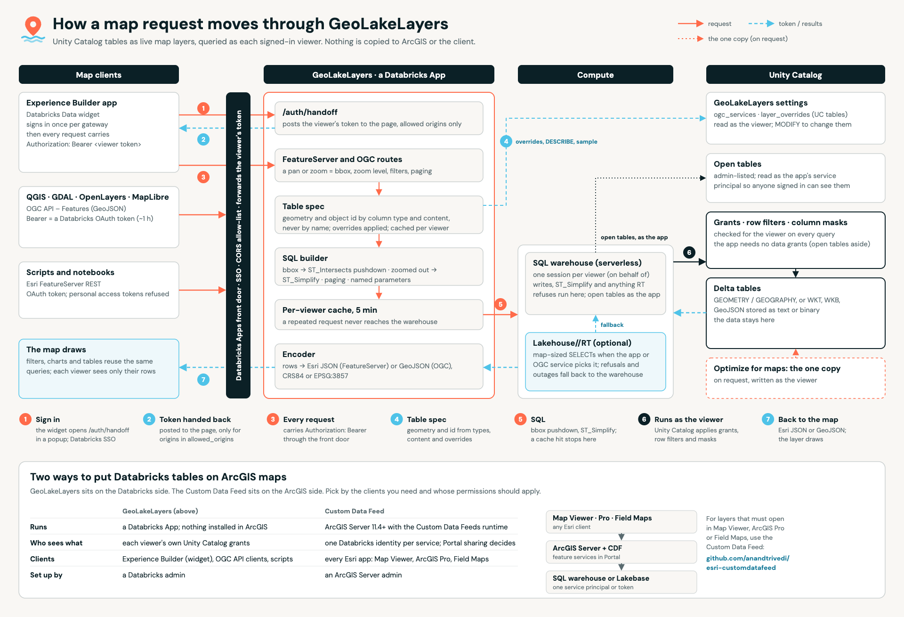

# How a map request moves through GeoLakeLayers

`geolakelayers-dataflow.svg` is the source (a PNG export at 1920 wide sits next to it). Both are generated:

    python3 docs/architecture/dataflow.py     # writes the SVG
    node docs/architecture/export.mjs         # writes the PNG with DM Sans (needs test/ npm install)

## The numbered flows

1. **Sign in.** The Databricks Data widget opens `/auth/handoff?origin=<page>` in a popup. The Databricks Apps
   front door signs the viewer in with Databricks SSO; the app itself never sees a password.
2. **Token handed back.** The handoff page posts the viewer's forwarded token to the page that opened it, only
   if that page's origin is in `allowed_origins`. QGIS, GDAL and scripts skip 1–2 and bring their own Databricks
   OAuth token (personal access tokens are refused by the front door).
3. **Every request carries `Authorization: Bearer`.** A pan or zoom becomes a FeatureServer query or an OGC
   items request (bbox, zoom level, filters, paging). The front door checks the token and CORS, then forwards it.
4. **Table spec.** The gateway works out the geometry column and object id by column type and content, never by
   name: GEOMETRY/GEOGRAPHY first, else text or binary columns sampled with `try_to_geometry`, plus any override
   from the settings table. The result is cached per viewer.
5. **SQL.** The bbox becomes an `ST_Intersects` filter pushed down to the warehouse; zoomed-out line and polygon
   tiles are wrapped in `ST_Simplify`. A repeat of the same request within 5 minutes is answered from the
   per-viewer cache and never reaches the warehouse.
6. **Runs as the viewer.** The statement runs in that viewer's own warehouse session, so Unity Catalog applies
   their grants, row filters and column masks. If the app or OGC service picked a Lakehouse//RT warehouse,
   map-sized SELECTs go there; writes, `ST_Simplify` and anything RT refuses go to the regular warehouse, and a
   circuit breaker covers RT outages.
7. **Back to the map.** Rows are encoded as Esri JSON (FeatureServer) or GeoJSON (OGC, CRS84 or EPSG:3857), and
   the layer draws. Filters, charts and tables in Experience Builder reuse the same queries.

## What is and isn't copied

Nothing is copied to ArcGIS or the client: every request reads the Delta table where it lives. The one exception
is **Optimize for maps**, which, when someone asks for it in the console, writes a map-friendly copy (native
GEOMETRY plus bounding-box columns, clustered) with that person's permissions.

## Two kinds of reads that aren't the viewer

- **Settings tables** (`ogc_services`, `layer_overrides`) are ordinary Unity Catalog tables, read as the viewer;
  changing them needs MODIFY.
- **Open tables**, listed by the gateway admin in `open_tables`, are read as the app's service principal on the
  bound warehouse, so anyone who can sign in sees them. That is the only data the app itself needs grants on.

## GeoLakeLayers or the Custom Data Feed?

The bottom panel contrasts the two paths: GeoLakeLayers runs on the Databricks side and queries as each viewer;
the [Custom Data Feed](https://github.com/anandtrivedi/esri-customdatafeed) runs inside ArcGIS Server and
serves every Esri app (Map Viewer, ArcGIS Pro, Field Maps) with one Databricks identity per service.
