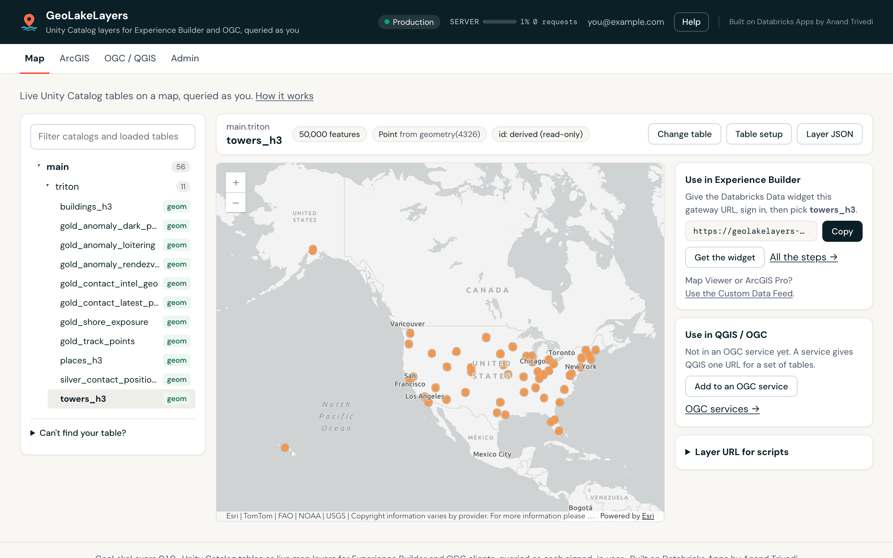
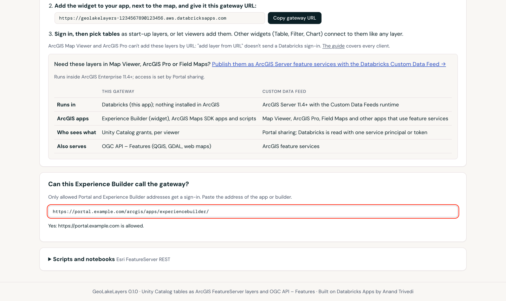
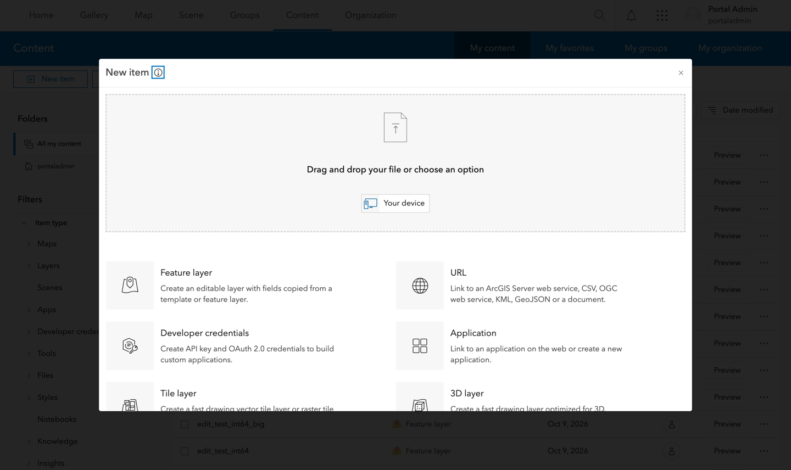
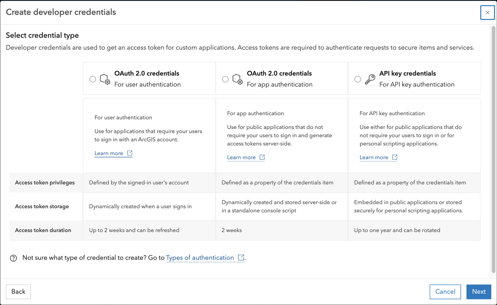
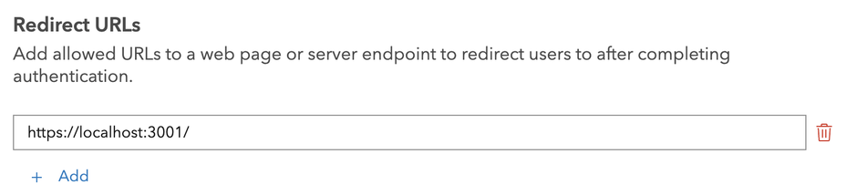
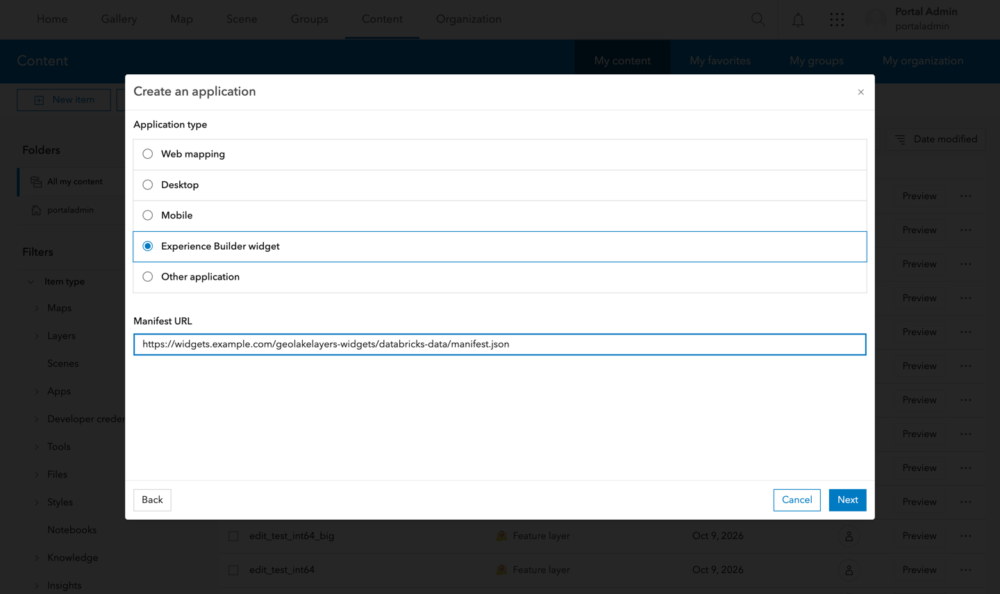
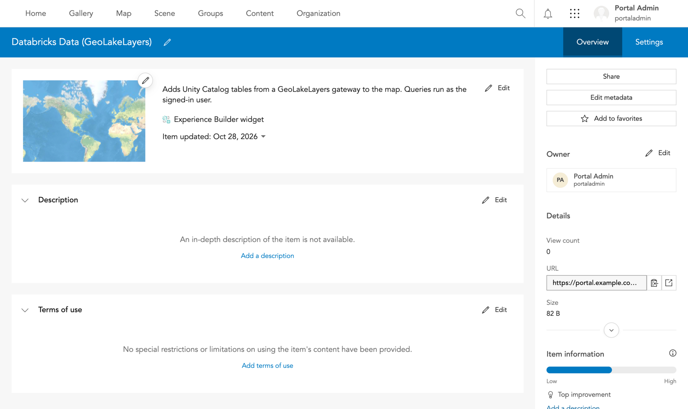
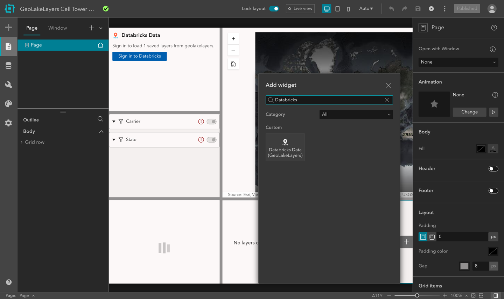
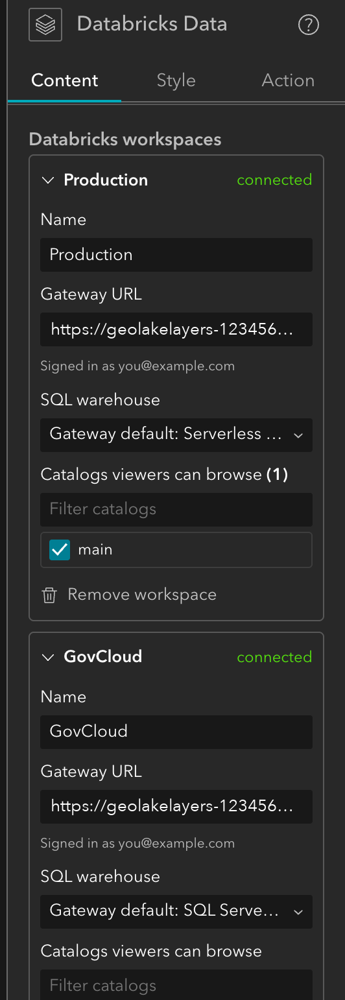
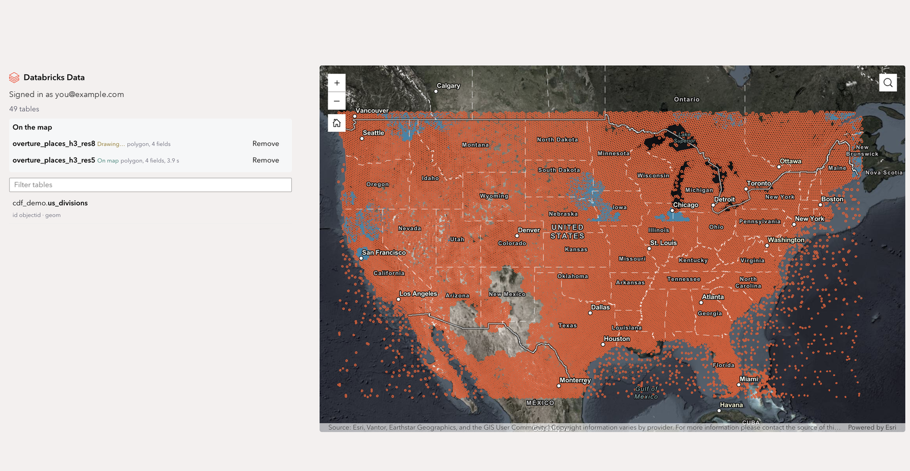

# Installing GeoLakeLayers

This walks through a full install: the gateway in Databricks, then the Databricks Data widget in Experience
Builder. If you only need OGC clients (QGIS, GDAL, web maps, scripts), steps 1 and 2 are all you need.

| Step | Who | Where | Needed for |
|---|---|---|---|
| 1. Deploy the gateway | Databricks admin | Databricks workspace | everything |
| 2. Allow your map clients' addresses | Databricks admin | the gateway's bundle target | Experience Builder, browser maps |
| 3. Install the widget in Developer Edition | ArcGIS admin | your machine + Portal | Experience Builder |
| 4. Register the widget in Portal's Experience Builder | ArcGIS admin | a web server + Portal | Portal's built-in Experience Builder |
| 5. Add the widget to an app | app author | Experience Builder | Experience Builder |

You need the Databricks CLI (tested with v1.17) signed in to the workspace, permission to create a Databricks
App with user authorization, and a SQL warehouse (serverless recommended) with spatial SQL. For the widget:
Experience Builder Developer Edition **1.20** and ArcGIS Enterprise **12.1** (the versions it was tested with).

## 1. Deploy the gateway

The gateway is a Databricks Asset Bundle in `gateway/`. Your workspace details go in
`gateway/targets.local.yml`, which is gitignored:

```bash
cp gateway/targets.example.yml gateway/targets.local.yml
```

Fill in one target per Unity Catalog metastore: the workspace host, the SQL warehouse id, and
`allowed_origins` (step 2). Then deploy and start the app:

```bash
cd gateway
databricks bundle deploy -t prod --profile <profile>
databricks bundle run gateway -t prod --profile <profile>
```

The last command prints the app's URL, `https://geolakelayers-<workspace-id>.<region>.databricksapps.com`.
That is the **gateway URL** every client uses.

Open it in a browser. The first time each person signs in, Databricks asks them to allow the app to use
Databricks SQL on their behalf; that is what makes every query run as them. After that the console opens on
a map.



> [!WARNING]
> **Changing the bundle name or `app_name` replaces the app.** Databricks deletes the old app and creates a
> new one with a new URL and a new service principal. Every Experience Builder app, QGIS connection and
> `directory` entry that used the old URL stops working, and grants made to the old service principal (for
> `open_tables`) have to be made again. Pick the name before you hand out the URL.

## 2. Allow your map clients' addresses

The gateway only hands a sign-in to browser pages whose address is in `allowed_origins`. Add every place the
widget or a browser map runs from:

- `https://localhost:3001` for Experience Builder Developer Edition,
- your Portal, for example `https://portal.example.com` (no path: an origin is scheme, host and port),
- any web map page that calls the OGC services from a browser.

```yaml
      allowed_origins: https://portal.example.com,https://localhost:3001
```

> [!IMPORTANT]
> **Redeploy after changing `allowed_origins`.** The setting is read when the app starts, so run both
> `databricks bundle deploy` and `databricks bundle run gateway` again. Until then, the widget's sign-in
> popup opens and closes and nothing loads.

To check an address, paste it into **Can this Experience Builder call the gateway?** on the console's ArcGIS
tab (also on the Admin tab):



## 3. Install the widget in Developer Edition

Custom widgets are built in Experience Builder Developer Edition. Download version 1.20 from Esri (it needs an
ArcGIS account), unzip it, and start its two parts:

```bash
cd ArcGISExperienceBuilder/server && npm ci && npm start          # https://localhost:3001
cd ArcGISExperienceBuilder/client && npm ci && npm start          # widget compiler (watch mode)
```

Copy the widget in, then restart the client's `npm start` once. It only picks up new widgets when it starts:

```bash
cp -R widget/databricks-data ArcGISExperienceBuilder/client/your-extensions/widgets/
```

Developer Edition signs in to your Portal through an OAuth app that you register in Portal. In Portal, open
**Content → New item** and choose **Developer credentials**:



Choose **OAuth 2.0 credentials — For user authentication**, then **Next**:



Add `https://localhost:3001/` as a redirect URL and finish creating the item. Note its **Client ID**.



> [!IMPORTANT]
> **Enter the redirect URL exactly, trailing slash included:** `https://localhost:3001/`. Portal compares
> redirect URLs character for character, so `https://localhost:3001` (no slash) or a different port makes
> Developer Edition's sign-in fail.

Open https://localhost:3001. The first time, Developer Edition asks for your Portal URL (for example
`https://portal.example.com/arcgis`) and the Client ID from the credentials item. Sign in with your Portal
account. **Databricks Data** now appears under **Custom** when you add a widget to an app.

## 4. Register the widget in Portal's Experience Builder

Developer Edition is only on your machine. To give everyone in Portal the widget, build it, host it on a web
server, and register it in Portal. This is the step most installs trip on.

**Build it** in the Developer Edition client:

```bash
cd ArcGISExperienceBuilder/client
npm run build:for-download
# output: dist-download/widgets/databricks-data/   (manifest.json, config.json, icon.svg, dist/)
```

**Host it.** Copy that `databricks-data` folder to a web server. Portal loads the widget straight from it in
each author's and viewer's browser, so the server has to be:

- **anonymous**: no sign-in in front of the files,
- **HTTPS with a publicly trusted certificate**: a self-signed or internal-CA certificate blocks the load,
- **sending CORS headers for your Portal's origin**.

> [!WARNING]
> **Check the hosting before you register it.** These must both work from your own machine:
>
> ```bash
> curl -I https://widgets.example.com/geolakelayers-widgets/databricks-data/manifest.json    # 200
> curl -sI -H 'Origin: https://portal.example.com' \
>   https://widgets.example.com/geolakelayers-widgets/databricks-data/manifest.json | grep -i access-control-allow-origin
> ```
>
> No `Access-Control-Allow-Origin` header means Portal will register the item, but Experience Builder can't
> load the widget.

Any static web server works. We host it as its own webapp in the Tomcat that already runs Portal's Web
Adaptor: a folder `webapps/geolakelayers-widgets/` holding `databricks-data/` and this
`WEB-INF/web.xml`, which turns on CORS for that webapp only:

```xml
<?xml version="1.0" encoding="UTF-8"?>
<!-- Static host for the GeoLakeLayers Experience Builder widget. CORS only for this webapp. -->
<web-app xmlns="https://jakarta.ee/xml/ns/jakartaee" version="6.0">
  <filter>
    <filter-name>CorsFilter</filter-name>
    <filter-class>org.apache.catalina.filters.CorsFilter</filter-class>
    <init-param><param-name>cors.allowed.origins</param-name><param-value>https://portal.example.com</param-value></init-param>
    <init-param><param-name>cors.allowed.methods</param-name><param-value>GET,HEAD,OPTIONS</param-value></init-param>
  </filter>
  <filter-mapping><filter-name>CorsFilter</filter-name><url-pattern>/*</url-pattern></filter-mapping>
  <mime-mapping><extension>json</extension><mime-type>application/json</mime-type></mime-mapping>
</web-app>
```

Tomcat deploys a new folder under `webapps/` by itself after a few seconds (`autoDeploy`); there is no
restart. Make the folder readable by Tomcat's user.

**Register it.** As a Portal administrator, open **Content → New item → Application**, choose **Experience
Builder widget**, and paste the URL of the hosted `manifest.json`:



Click **Next**, give it a title (for example *Databricks Data (GeoLakeLayers)*), and save. Then **Share** the
item with the people or groups who build apps; an item only you can see is a widget only you can add.



Finally, make sure your Portal's origin is in the gateway's `allowed_origins` (step 2) and that you
redeployed.

> [!NOTE]
> **Updating the widget later:** rebuild, copy the new folder over the old one on the web server, and reload
> Experience Builder. The Portal item points at the URL, so it doesn't change. If you move the widget to a new
> URL, edit the item's URL in its settings.

## 5. Add the widget to an app

In Experience Builder (Developer Edition or Portal's), open an app, add a widget and search for
*Databricks*. It's listed under **Custom**:



Put it next to the map, then in its settings:

1. Pick the map it adds layers to.
2. Add a workspace: paste the gateway URL (the console's Map and ArcGIS tabs have a copy button) and sign in.
3. Choose the SQL warehouse, which catalogs viewers may browse, and the tables that load when the app opens.



Save and publish. Viewers sign in to Databricks once, and the tables behave like other layers in Map Layers,
Legend, Table, Filter and Chart:



## If it doesn't work

| What you see | Most likely cause |
|---|---|
| Developer Edition sign-in fails with a redirect error | The credentials item's redirect URL is missing, or lacks the trailing `/` |
| The widget isn't listed under Custom in Portal's Experience Builder | The item isn't shared with you, or the manifest URL doesn't load (certificate, CORS, sign-in in front of it) |
| The widget shows but its panel stays blank | The widget's other files (`dist/`) aren't on the server next to `manifest.json`, or CORS only covers some paths |
| The sign-in popup opens and closes, and nothing loads | The page's origin isn't in `allowed_origins`, or the gateway wasn't redeployed after adding it |
| Nothing happens on **Sign in** | The browser blocked the popup; allow pop-ups for the site |
| Apps stopped loading after a redeploy | The bundle name or `app_name` changed, so the gateway has a new URL (step 1) |
| A table is missing or a layer is empty | The person lacks `USE CATALOG`, `USE SCHEMA`, `SELECT` on it, or `CAN USE` on the warehouse |

The [guide](guide.md) covers each client in more detail, and the README's Deployment section lists who needs
which Unity Catalog grant.
