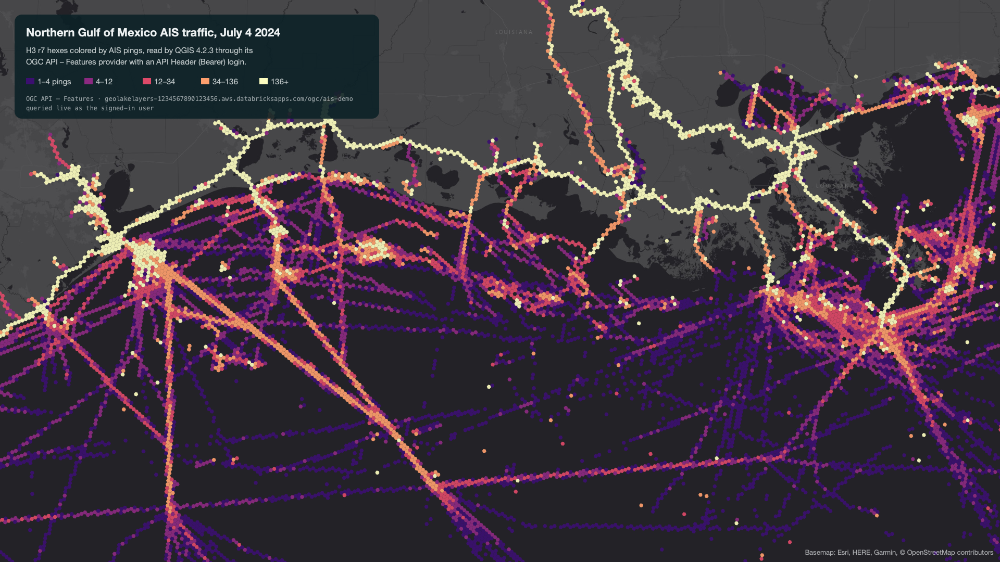
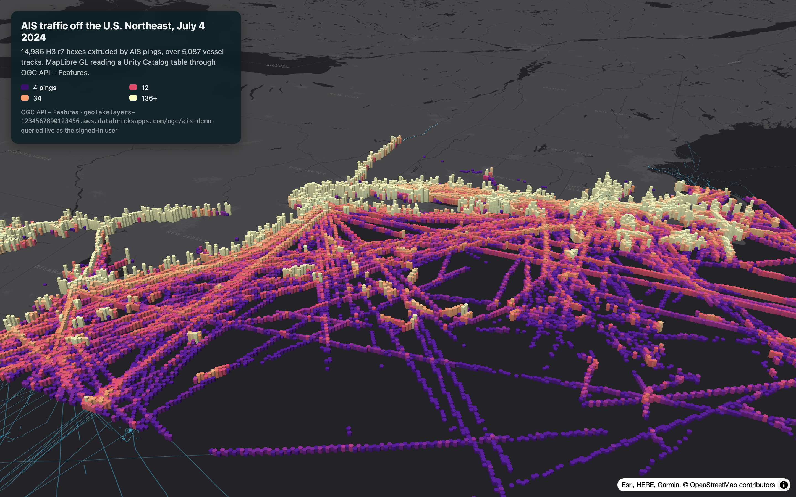
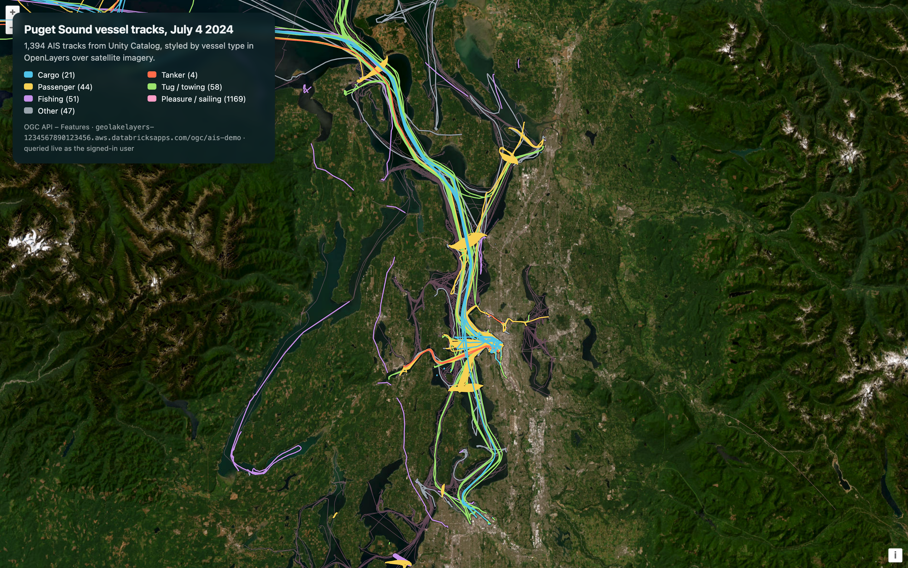
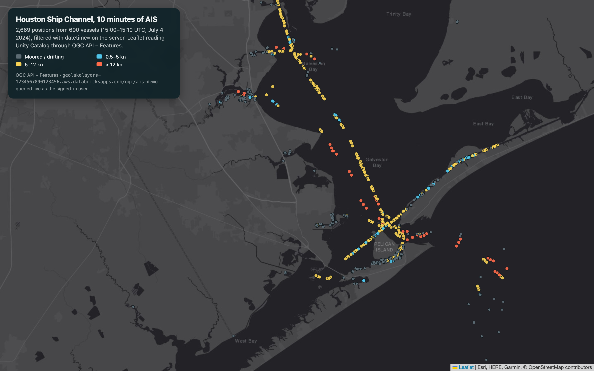

# OGC API – Features clients

Every OGC service in GeoLakeLayers is a plain OGC API – Features endpoint (Part 1 Core + GeoJSON, Part 2 CRS),
so any client that speaks the standard can read it. Each request carries a Databricks OAuth token
(`Authorization: Bearer …`) and runs as that person, so Unity Catalog decides what they see.

These maps all read the same service, `ais-demo` (NOAA AIS for July 4 2024: points, H3 r7 hexes and tracks),
straight from Unity Catalog. Nothing was exported or copied first.

| | |
|---|---|
|  |  |
| **QGIS 4.2**: H3 r7 hexes along the northern Gulf coast, colored by AIS pings, through QGIS's own OGC API – Features provider. | **MapLibre GL**: the same hexes off the U.S. Northeast, extruded by ping count (log scale) over the day's tracks. |
|  |  |
| **OpenLayers**: a day of Puget Sound vessel tracks over satellite imagery, by vessel type (commercial on top). | **Leaflet**: ten minutes of AIS positions in Galveston Bay, picked on the server with `datetime=`, colored by speed. |

## What every client needs

- **The service's landing page URL**: `https://<gateway>/ogc/<service>`. Copy it from the console's **OGC / QGIS**
  tab. Clients find the collections from there.
- **A Databricks OAuth token**, sent as `Authorization: Bearer <token>`. Use **Copy a token** in the console, or
  `databricks auth token --host https://<workspace> | jq -r .access_token`. Tokens last about an hour.
  Personal access tokens are not accepted.
- **Browser apps only:** the page's origin must be in the gateway's `allowed_origins`, because the browser sends
  a CORS preflight for the `Authorization` header.
- **Paging:** at most 4000 features per request. Follow the `rel=next` link. Use `bbox=` and, on collections with
  a time field, `datetime=` to ask only for what the map shows.

## QGIS

1. **Settings → Options → Authentication → +**. Pick **API Header**, add a header named `Authorization` with the
   value `Bearer <token>`, and save it as, say, *GeoLakeLayers*.
2. **Layer → Data Source Manager → WFS / OGC API – Features → New**. For URL, paste the landing page URL. For
   Authentication, pick the config from step 1. Leave Version on *Maximum* or *OGC API – Features*.
3. **Connect**, select collections, then **Add**. When the token expires (about an hour), paste a new one into
   the same auth config.

## GDAL / OGR

Put the header in a file and point GDAL at it. On GDAL 3.13.3, `GDAL_HTTP_HEADER_FILE` worked and
`GDAL_HTTP_HEADERS` was rejected with HTTP 401.

```bash
TOKEN=$(databricks auth token --host https://<workspace> | jq -r .access_token)
umask 077; printf 'Authorization: Bearer %s\n' "$TOKEN" > ~/.geolakelayers-header
# List the collections
ogrinfo --config GDAL_HTTP_HEADER_FILE ~/.geolakelayers-header -ro -so "OAPIF:https://<gateway>/ogc/<service>"
# Copy one collection, for one area, to a GeoPackage
ogr2ogr --config GDAL_HTTP_HEADER_FILE ~/.geolakelayers-header -f GPKG galveston.gpkg \
  "OAPIF:https://<gateway>/ogc/<service>" hex_r7 -spat -95.3 29.0 -94.6 29.8
```

## Web maps

Load the items with `fetch` (which can send the header), then hand the GeoJSON to the map. `items()` in
[`test/ogc-clients/common.js`](../test/ogc-clients/common.js) follows the `next` links for you.

```js
async function items (url) { // url: .../collections/<id>/items?f=json&limit=4000&bbox=...
  const features = []
  while (url) {
    const page = await (await fetch(url, { headers: { Authorization: `Bearer ${token}` } })).json()
    features.push(...page.features)
    url = page.links.find(l => l.rel === 'next')?.href
  }
  return { type: 'FeatureCollection', features }
}
```

**OpenLayers**

```js
const source = new ol.source.Vector()
source.addFeatures(new ol.format.GeoJSON().readFeatures(await items(url), { featureProjection: 'EPSG:3857' }))
map.addLayer(new ol.layer.Vector({ source }))
```

**MapLibre GL**

```js
map.addSource('hexes', { type: 'geojson', data: await items(url) })
map.addLayer({ id: 'hexes', type: 'fill', source: 'hexes', paint: { 'fill-color': '#de4968' } })
// or let MapLibre fetch the URL itself and add the header in the map options:
//   transformRequest: u => u.startsWith(gateway) ? { url: u, headers: { Authorization: `Bearer ${token}` } } : { url: u }
```

**Leaflet**

```js
L.geoJSON(await items(url), { pointToLayer: (f, ll) => L.circleMarker(ll, { radius: 3 }) }).addTo(map)
```

## The showcase pages

The four images above come from [`test/ogc-clients/`](../test/ogc-clients). It has one page per web client, a
QGIS script, and a script that takes the screenshots. The libraries are served from `node_modules`, not a CDN.

```bash
cd test/ogc-clients && npm install
# Web pages: serves this folder on http://localhost:5199 (must be in allowed_origins) and screenshots each page
node shots.mjs https://<gateway> <databricks profile> [maplibre openlayers leaflet]
# QGIS (headless), with QGIS's own Python
C=/Applications/QGIS-final-4_2_3.app/Contents; R=$C/Resources/python3.12
PYTHONHOME=$C/Resources PYTHONPATH=$R:$R/lib-dynload:$R/site-packages:$C/Resources/python \
  $C/MacOS/python3.12 qgis-render.py https://<gateway>/ogc/ais-demo <databricks profile>
```

To open a page yourself, use
`http://localhost:5199/maplibre.html?gateway=https://<gateway>#token=<token>`. The `#token` fragment is never
sent to a server.

Basemaps: Esri Dark Gray Canvas and World Imagery (keep the attribution).
